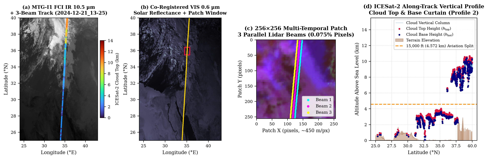
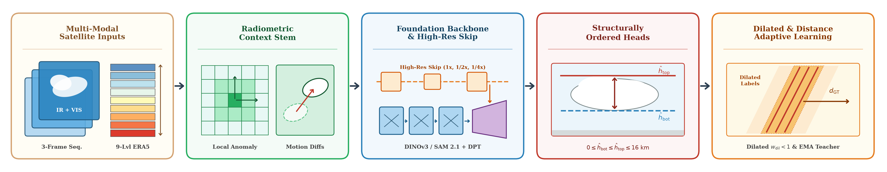
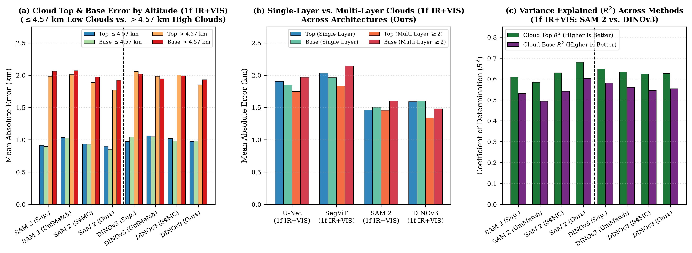
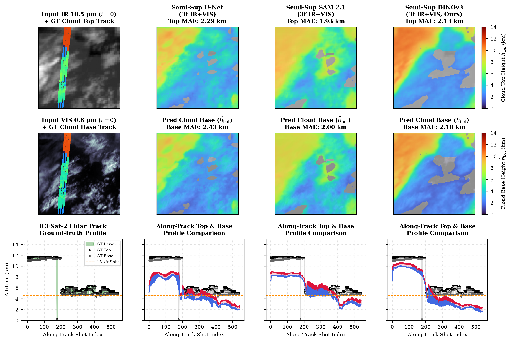

# CloudTrack-3D: A Multi-Temporal Satellite–Lidar Benchmark and Semi-Supervised Foundation Framework for Dense 3D Cloud Reconstruction

[](https://huggingface.co/datasets/cloudTrack3D/CloudTrack-3D)
[](https://opensource.org/licenses/MIT)

Official PyTorch implementation, benchmark evaluation suite, and dataset tools for **CloudTrack-3D**: reconstructing dense 2D maps of **cloud presence**, **cloud top altitude (km)**, and **cloud base altitude (km)** from multi-temporal, dual-spectral geostationary satellite imagery (**EUMETSAT MTG-I1 FCI**) and atmospheric reanalysis (**ECMWF ERA5**) supervised by ultra-sparse (**0.075%** pixel density) 3-beam spaceborne photon-counting lidar curtains (**NASA ICESat-2 ATL09**).

<p align="center">
  
</p>

---

## Key Contributions

- **Multi-Temporal Active–Passive–Reanalysis Benchmark (`CloudTrack-3D`)**:
  - Pairs **490 deduplicated ICESat-2 ATL09** 3-beam lidar overpasses (**> 6.1M** lidar profile shots) with full-resolution **4096 × 4096 EUMETSAT MTG-I1 FCI** geostationary imagery (Lon **0°–45°E**, Lat **25°–40°N**) and **18-channel hourly ERA5 pressure-level profiles** (**200–900 hPa** Temperature & Relative Humidity) across November 2024 – November 2025.
  - Includes **408 complete 30-minute dual-spectral sequences** (`t = 0, -15, -30 min` across thermal **IR 10.5 μm** and visible solar reflectance **VIS 0.6 μm**), plus a strict **14-day synoptic-block split** with a **±48-hour** exclusion buffer.
- **Physics-Guided Vision Foundation Model Adaptation**:
  - Adapts pretrained **DINOv3 (`vit_base_patch16_dinov3`)** and **SAM 2 (`sam2_hiera_small`)** alongside **SegViT** and **U-Net** via a `RadiometricContextStem`, a zero-initialized residual `FoundationInputAdapter`, a parallel high-resolution (`1×, 1/2×, 1/4×`) convolutional skip pathway preserving 1-pixel lidar track alignment, and a structurally ordered dual-height head (`h_bot = h_top · σ(z_ratio)`) guaranteeing **0.0% physical ordering violations** (`0 ≤ h_bot ≤ h_top`).
- **Bilateral Dilated & Distance-Adaptive Semi-Supervised Learning (`Ours`)**:
  - Combines **Bilateral Dilated Ground-Truth Supervision**—propagating exact 1-pixel lidar ground truth across a radiometrically gated near-track corridor (`0 < d_GT(r,c) ≤ r_dil`) with strictly decayed weight `w_dil(r,c) ≤ γ_dil < 1`—and **GT-Distance Adaptive Consistency**, scaling teacher–student pseudo-label confidence thresholds `τ_c(d_GT), τ_r(d_GT)` monotonically with Euclidean distance `d_GT(r,c)` from the lidar curtain to prevent far-field confirmation bias.

<p align="center">
  
</p>

---

## Repository Structure

```text
.
├── dataset.py                                   # Co-registration, 3-beam ICESat-2 projection, 1f/3f IR+VIS & ERA5 datasets
├── era5_db.py                                   # ERA5 pressure-level reader & temporal interpolator (supports HF .npz & raw .npy)
├── models.py                                    # RadiometricContextStem, U-Net, SegViT, SAM 2, DINOv3, Structural Ordering Head
├── losses.py                                    # Supervised, UniMatch, S4MC, Bilateral Dilated & Distance-Adaptive SSL losses
├── augmentations.py                             # Weak geometric & multi-frame coherent strong radiometric + CutMix augmentations
├── train_supervised.py                          # Multi-GPU supervised training entry point
├── train_semisup.py                             # Multi-GPU EMA Teacher + Dual-Stream semi-supervised training entry point
├── run_s4mc_and_dist_ours.py                    # Training & evaluation of S4MC and Bilateral Dilated + Distance-Adaptive SSL (Ours)
├── run_ours_1f_vis_component_ablation.py        # Component & hyperparameter sensitivity ablation suite on 1f IR+VIS
├── run_cvpr_experiments.py                      # Classical/GBDT baselines, modality disentanglement, beam sparsity & synoptic splits
├── run_era5_experiments.py                      # ERA5 reanalysis integration & meteorological benchmark experiments
└── run_extended_era5_analysis.py                # Pressure-slab, thermodynamic channel & forecast lead-time experiments
```

---

## Installation & Dataset Download

### 1. Environment Setup
```bash
git clone https://github.com/cloudTrack3D/cloudTrack3D.git
cd cloudTrack3D
pip install -r requirements.txt
```

### 2. Download the `CloudTrack-3D` Dataset from Hugging Face Hub
The complete benchmark dataset (`490` ICESat-2 `ATL09` lidar granules, `1,467` 3-frame **IR 10.5 μm** images, `1,252` 3-frame **VIS 0.6 μm** images, `490` matched 18-channel ERA5 profiles, and official split manifests) is hosted at [**`https://huggingface.co/datasets/cloudTrack3D/CloudTrack-3D`**](https://huggingface.co/datasets/cloudTrack3D/CloudTrack-3D):

```bash
mkdir -p ../data && cd ../data
huggingface-cli download cloudTrack3D/CloudTrack-3D --repo-type dataset --local-dir .

# Unpack the satellite and lidar archives into ../data/{vfms,ir10.5,vis0.6}
tar -xf vfms_490.tar
tar -xf ir105_matched_1467.tar
tar -xf vis06_matched_1252.tar
cd ../cloudTrack3D
```

---

## Running Training, Evaluation & Ablations

### 1. Supervised & Semi-Supervised Training (`Supervised`, `UniMatch`, `S4MC`, `Ours`)
```bash
# Train Supervised baseline (e.g., SAM 2 or DINOv3 on 3f IR+VIS)
python train_supervised.py --arch dinov3 --temporal-3frames --use-vis06 --epochs 40 --batch-size 16 \
    --output-dir outputs/supervised_dinov3_3f_vis

# Train UniMatch semi-supervised model
python train_semisup.py --arch dinov3 --temporal-3frames --use-vis06 --epochs 60 --batch-size 16 \
    --init-checkpoint outputs/supervised_dinov3_3f_vis/best_supervised.pt \
    --output-dir outputs/semisup_dinov3_3f_vis

# Train & evaluate S4MC and Bilateral Dilated + Distance-Adaptive SSL (Ours) across all regimes
python run_s4mc_and_dist_ours.py
```

### 2. Component Ablation, Sparsity, Synoptic Split & ERA5 Suites
```bash
# Run 1f IR+VIS component & hyperparameter ablation study across U-Net and SAM 2
python run_ours_1f_vis_component_ablation.py

# Run modality disentanglement, 1/2/3-beam lidar sparsity & synoptic-block split suite
python run_cvpr_experiments.py --step all

# Run ERA5 reanalysis & forecast lead-time experiments
python run_era5_experiments.py
python run_extended_era5_analysis.py
```

---

## Main Benchmark Results

| Modality Regime | Architecture | Method | Acc (%) ↑ | F1 (%) ↑ | Cloud IoU (%) ↑ | AUROC (%) ↑ | Top MAE (km) [All / Low ≤ 4.57 km / High > 4.57 km] ↓ | Base MAE (km) [All / Low ≤ 4.57 km / High > 4.57 km] ↓ |
| :--- | :--- | :--- | :---: | :---: | :---: | :---: | :---: | :---: |
| **1f Still IR** *(490 Split)* | Lapse-Rate Inv. | Physical | 86.30 | 69.10 | 52.79 | 85.89 | 2.805 / 2.863 / 2.753 | 2.591 / 2.548 / 2.642 |
| **1f Still IR** *(490 Split)* | HistGBDT | Tabular | 85.57 | 71.16 | 55.23 | 87.61 | 2.831 / 2.762 / 2.893 | 2.566 / 2.512 / 2.629 |
| **1f Still IR** *(490 Split)* | U-Net | **Ours (Dilated+Dist)** | 90.02 | 80.52 | 67.39 | 93.45 | 2.263 / 2.411 / 2.132 | 2.094 / 2.189 / 1.981 |
| **1f Still IR** *(490 Split)* | SegViT | **Ours (Dilated+Dist)** | 89.64 | 79.90 | 66.53 | 93.31 | 2.142 / 2.463 / 1.855 | 2.011 / 2.382 / 1.573 |
| **1f Still IR** *(490 Split)* | DINOv3 | **Ours (Dilated+Dist)** | 89.26 | 79.23 | 65.60 | 93.02 | 1.995 / 2.275 / 1.745 | 1.902 / 2.111 / 1.655 |
| **1f Still IR** *(490 Split)* | **SAM 2** | **Ours (Dilated+Dist)** | **91.18** | **83.48** | **71.64** | **94.15** | **1.701 / 1.622 / 1.771** | **1.717 / 1.594 / 1.862** |
| | | | | | | | | |
| **1f IR+VIS** *(408 Split)* | U-Net | **Ours (Dilated+Dist)** | 89.75 | 74.67 | 59.57 | 88.41 | 1.875 / 1.096 / 2.301 | 1.871 / 1.071 / 2.346 |
| **1f IR+VIS** *(408 Split)* | SegViT | **Ours (Dilated+Dist)** | 89.20 | 73.13 | 57.64 | 86.26 | 1.996 / 1.355 / 2.345 | 1.996 / 1.307 / 2.405 |
| **1f IR+VIS** *(408 Split)* | DINOv3 | **Ours (Dilated+Dist)** | 89.42 | 74.46 | 59.31 | 89.91 | 1.542 / 0.974 / 1.852 | 1.577 / 0.981 / 1.930 |
| **1f IR+VIS** *(408 Split)* | **SAM 2** | **Ours (Dilated+Dist)** | **90.15** | **75.73** | **60.94** | **91.10** | **1.463 / 0.899 / 1.770** | **1.521 / 0.846 / 1.922** |
| | | | | | | | | |
| **3f IR+VIS** *(408 Split)* | U-Net | **Ours (Dilated+Dist)** | 89.84 | 75.04 | 60.05 | 91.05 | 1.612 / 0.842 / 2.033 | 1.658 / 0.785 / 2.175 |
| **3f IR+VIS** *(408 Split)* | SegViT | **Ours (Dilated+Dist)** | 89.51 | 74.42 | 59.26 | 89.95 | 1.884 / 1.154 / 2.283 | 1.851 / 1.062 / 2.318 |
| **3f IR+VIS** *(408 Split)* | **SAM 2** | **Ours (Dilated+Dist)** | 90.02 | 76.04 | 61.34 | 92.35 | **1.263** / 0.835 / **1.497** | 1.305 / 0.789 / 1.611 |
| **3f IR+VIS** *(408 Split)* | **DINOv3** | **Ours (Dilated+Dist)** | **90.42** | **77.10** | **62.73** | **93.12** | 1.264 / **0.788** / 1.524 | **1.247 / 0.701 / 1.571** |

<p align="center">
  
</p>

<p align="center">
  
</p>

---

## License

This repository is released under the MIT License, and the CloudTrack-3D dataset is released under CC-BY-4.0.
